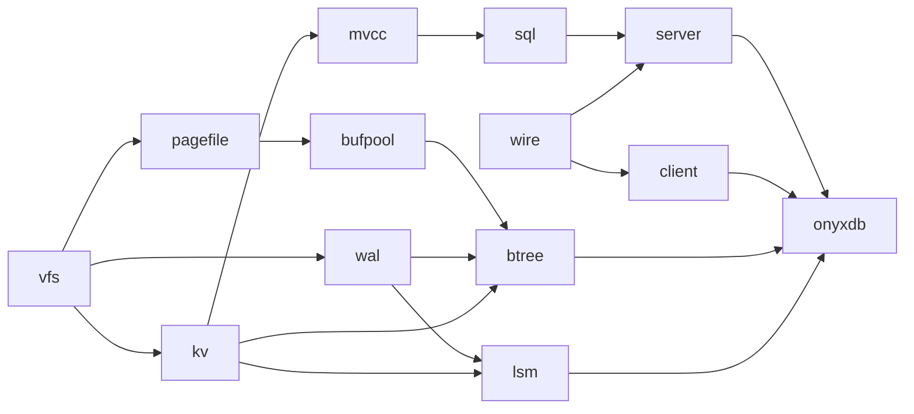
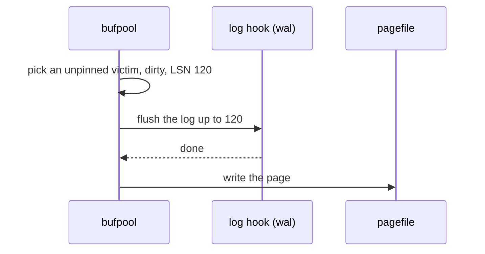
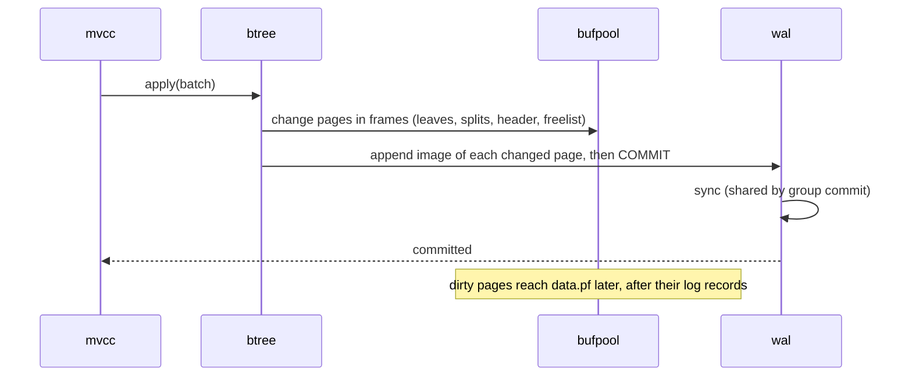
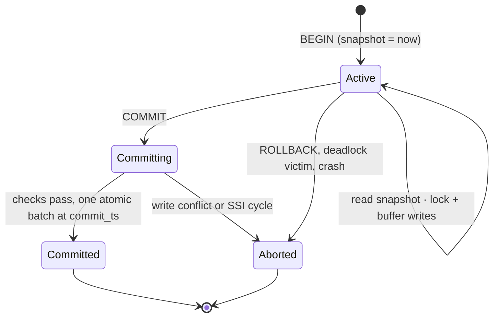
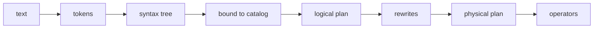
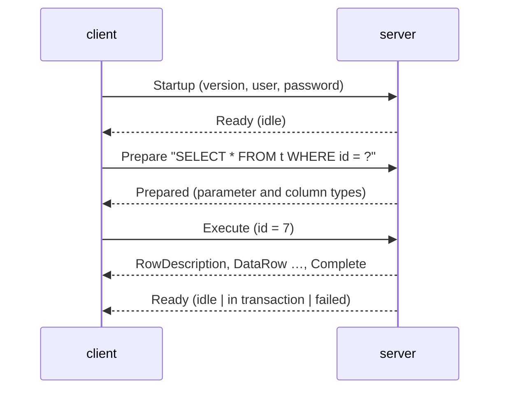
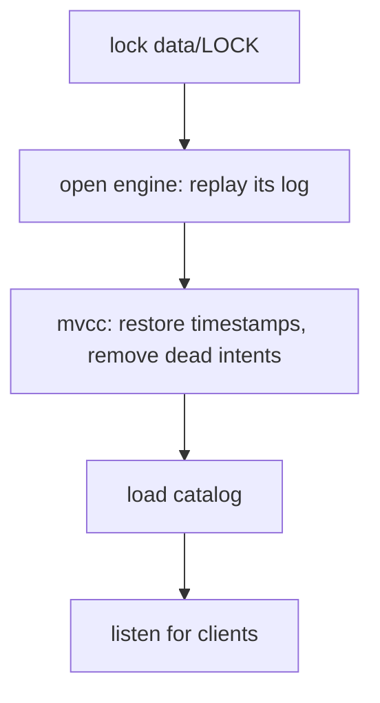
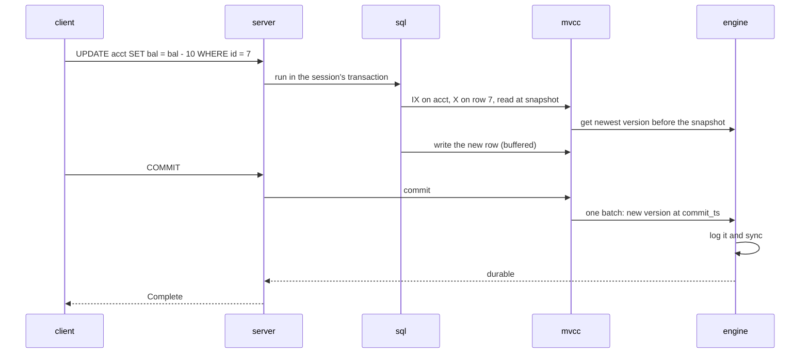

# Architecture

onyxdb is a SQL database built to learn how databases work inside. It covers what a real database must do: store data in its own format, survive crashes, cache pages, index, run SQL, isolate transactions, and serve many clients. Where there's a choice, it takes the simplest design that's still correct. Speed comes second.

Only `vfs` and `pagefile` exist so far, and both are done. Everything else here is the plan. As each crate is built, its README describes how it actually works.

## Principles

- **Standard library only.** Every layer is written here: formats, data structures, the query language, the protocol.
- **One crate per layer.** Dependencies point down. A lower crate that needs something from above defines a trait.
- **Correct before fast.** No stage exists only for speed.
- **Every layer is tested alone,** against a simple model, and everything that writes to disk is crashed at every write.

## The layers

```text
     client               library + REPL
        │  wire           messages both sides share
     server               sessions, login, limits
        │
       sql                parse → plan → execute
        │
      mvcc                transactions, locks, versions
        │
       kv                 one ordered key-value interface
   ┌────┼─────────────┐
 model btree         lsm  three engines behind it
        │             │
     bufpool          │
        │             │
     pagefile        wal  pages; the log
        └──── vfs ────┘   every file operation
```

`onyxdb` sits on top: the binary that owns the data directory, picks the engine, recovers, and starts the server.

## Build order



| Builds | What works afterwards |
|---|---|
| 1–4 `vfs` `pagefile` `bufpool` `wal` | pages on disk, cached, with a crash-safe log |
| 5–10 `kv` `mvcc` `sql` `wire` `server` `client` | the whole database, end to end, on the in-memory model engine |
| 11–12 `btree` `lsm` | real storage under the same SQL |
| 13 `onyxdb` | one binary, crash-tested end to end |

## The data directory

```text
data/
  LOCK              held by the running process. A second one is refused
  onyxdb.conf       engine, port, memory budget
  btree/            when the B-tree engine was chosen
    data.pf           the page file
    wal.log           page images of committed batches
  lsm/              when the LSM engine was chosen
    MANIFEST          which tables make up the tree
    wal.log           batches not yet flushed to a table
    000012.sst ...    sorted tables
```

The engine is chosen when the directory is created and never changes.

## 1. Files: `vfs`

Every file operation goes through two traits, so tests can swap the disk for one that crashes on command.

```text
Vfs   open · exists · remove · rename · create_dir · list · sync_dir
File  read_at · write_at · len · set_len · sync · try_lock
```

| Implementation | Use |
|---|---|
| `Disk` | the real file system, below a root directory |
| `Mem` | in memory: keeps synced and unsynced data apart, crashes from a seed, injects faults |

What a crash keeps in `Mem`:

| | Survives when |
|---|---|
| file bytes | always, once synced. Later writes are kept, lost or torn, per 512-byte sector |
| names | always, once synced with `sync_dir`. Later changes survive as a prefix |
| after a failed `sync` | the unsynced writes are gone for good |

`crash_test` runs any workload, cuts the power after every change it makes, crashes with many seeds, and checks what's left. Every layer above uses it.

## 2. Pages: `pagefile`

A file is a numbered array of fixed-size pages. Every page carries its kind, its LSN and a checksum.

```text
page n at byte n × page size

0      1          9                               size-4     size
┌──────┬──────────┬───────────────────────────────┬──────────┐
│ kind │ LSN u64  │ the kind's own layout         │ CRC-32C  │
└──────┴──────────┴───────────────────────────────┴──────────┘
kinds: 0 empty · 1 free · 2 slotted · 3 overflow        page 0: the header
```

| Piece | What it does |
|---|---|
| header (page 0) | magic, version, page size, page count, freelist head, 32 bytes for the engine |
| slotted page | many variable-size items: slots at the front, items packed at the back |
| overflow chain | a value too big for a page, split across linked pages |
| freelist | freed pages, linked through themselves, reused before the file grows |
| `PageStore` | read and write pages by number. The freelist and overflow code work through it |

Allocation goes through `PageStore`. So with a buffer pool in front, every change lands in a cached frame and is logged before it reaches the file. That includes changes to the header and the freelist.

## 3. Buffer pool: `bufpool`

A fixed set of frames holds pages in memory. Callers pin a page while they use it.

```text
page table (own hash table)        frames
┌─────────┬───────┐            ┌─────────────────────────────┐
│ page 7  │ → 2   │ ─────────▶ │ 2: page 7  pins 1  dirty     │
│ page 3  │ → 0   │ ─────────▶ │ 0: page 3  pins 0  clean     │
└─────────┴───────┘            │ 1: free                      │
                               └─────────────────────────────┘
```

- **Eviction** picks an unpinned frame, behind a trait: CLOCK, then LRU-K, which a sequential scan can't flush.
- **The write-ahead rule.** A dirty page may reach the file only after the log is on disk up to its LSN. The pool asks through a hook trait it defines, and the B-tree plugs `wal` into it.
- **Latches** protect frames for the few instructions of a read or write. None is held during I/O.



## 4. Write-ahead log: `wal`

An append-only file of records. An LSN is a record's byte position, so it only grows.

```text
block (32 KiB)
┌───────────────────────────────────────────────────────┐
│ [len | type | crc | payload] [len | type | crc | ...]  │
└───────────────────────────────────────────────────────┘
types: whole · first · middle · last   (a record may span blocks)
```

- **Commit** appends records and calls `sync`. **Group commit** lets every writer waiting at that moment share one `sync`.
- **Replay** reads from the last checkpoint and stops cleanly at a torn record at the end.
- **Fuzzy checkpoints** record where replay can start, without stopping writers. The log before that point is deleted.

## 5. The storage contract: `kv`

Everything above storage sees one interface.

```rust
trait Kv: Send + Sync {
    fn get(&self, key: &[u8]) -> Result<Option<Vec<u8>>>;
    fn scan(&self, from: Bound<&[u8]>, to: Bound<&[u8]>) -> Result<Iter>; // key order
    fn apply(&self, batch: Batch, sync: bool) -> Result<()>;      // all or nothing
}
```

Three engines implement it: a `BTreeMap` model, the B-tree and the LSM tree. One test suite, random operations against the model plus a crash at every write, decides whether an engine is correct.

## 6. B-tree engine: `btree`

A B+tree on slotted pages. Leaves hold keys and values, and are linked left to right for scans. Interior nodes hold separator keys.

```text
                 ┌───────────┐
                 │  [g | p]  │                    interior
                 └─┬───┬───┬─┘
       ┌───────────┘   │   └───────────┐
 ┌─────▼─────┐   ┌─────▼─────┐   ┌─────▼─────┐
 │ a  c  f   │──▶│ g  k  m   │──▶│ p  t  z   │    leaves, right links
 └───────────┘   └───────────┘   └─────┬─────┘
                                       └──▶ overflow chain for a long value
```

**A committed batch.** Pages change in frames. The log gets a full image of every changed page, then a commit record.



**Recovery.** Replay page images of committed batches from the last checkpoint, in order, over `data.pf`. A batch with no commit record is ignored. Full images also repair a page that was torn mid-write. No undo is needed here: unfinished transactions are undone a layer up, in `mvcc`.

**Concurrency.** B-link right pointers: a reader that lands on a node mid-split follows the right link instead of restarting.

## 7. LSM engine: `lsm`

Writes go to memory first and are merged into sorted files in the background.

```text
write ──▶ wal.log ──▶ memtable (skip list)
                         │ full
                         ▼ flush
          L0  [sst] [sst]            may overlap
          L1  [sst][sst][sst]        sorted, no overlap
          L2  [sst][sst][sst][sst]   10× bigger each level
                         ▲ compaction merges a level into the next
read: memtable → L0 newest first → L1 → L2 …   (Bloom filters skip tables)
```

- An SSTable is sorted blocks, an index block, a Bloom filter and a footer. Deletes are tombstones until compaction drops them.
- The MANIFEST lists the live tables. It's replaced by write-sync-rename-`sync_dir`, so a crash mid-compaction leaves the old set or the new one.

## 8. Transactions: `mvcc`

Every write creates a new version. A transaction reads the newest version older than its snapshot.

```text
key in the engine:   user key | ¬commit_ts       (¬ = bits inverted, so newer versions sort first)

 "acct/7" ¬30  →  balance 80     ◀── a snapshot taken at 35 reads this
 "acct/7" ¬20  →  balance 100    ◀── a snapshot taken at 25 reads this
```



**Locks.** One lock manager, held until commit:

```text
table "acct"     IS / IX / S / X        intention locks on tables
  ├─ row 7          S / X                  row locks
  └─ range [5, 9)   S / X                  range locks (phantoms)
waits form a wait-for graph. A cycle is a deadlock, and the youngest transaction aborts
```

| Isolation | How |
|---|---|
| snapshot | reads use the snapshot. Each write X-locks its row. If the row changed since the snapshot, the writer aborts |
| serializable (SSI) | snapshot, plus tracking every key and range read. A dangerous read-write cycle aborts one transaction |
| `SELECT ... FOR UPDATE` | row and range locks, so others can neither change nor insert into what was read |

- **Timestamps** come from a counter that's saved, so a restart never reuses one.
- **Large transactions** write intents (uncommitted versions) as they go, plus a transaction record. Readers that meet an intent check the record. At startup, intents of transactions without a commit are removed.
- **Garbage collection** removes versions older than the oldest running snapshot.

## 9. SQL: `sql`



**Tables and indexes as keys.**

```text
row          table_id | primary key           →  row record
index entry  index_id | indexed columns | pk  →  (empty)
catalog      0 | "table" | name                →  schema
no primary key?  a hidden row id is the key
```

Keys are encoded so that byte order matches value order. That way a range in SQL becomes a range scan in `kv`.

| Piece | What it does |
|---|---|
| types | INTEGER, REAL, TEXT, BLOB, NULL, SQLite's comparison rules, three-valued logic |
| constraints | PRIMARY KEY, NOT NULL, UNIQUE. Every index is updated in the same transaction as its table |
| schema locks | a statement takes IS or IX locks on its tables. DDL takes X, so DROP waits for running queries |
| prepared statements | parse and plan once, bind `?` parameters, run many times |
| operators | Volcano iterators: scan, index scan, filter, project, limit, aggregate, nested-loop, sort-merge and hash joins |
| memory budget | external merge sort, and hash joins and aggregates that spill partitions to disk |
| optimizer | rewrites (predicate pushdown), index choice, join order from `ANALYZE` statistics, and `EXPLAIN` |

## 10. Talking to clients: `wire`, `server`, `client`



- Frames are a type byte, a length and a body. Errors carry a code, so a client can tell "retry this" from "fix this".
- One session per connection, holding that connection's transaction state. A bounded thread pool refuses work it can't take.
- Idle and query timeouts, cancel, and a shutdown that rolls back open transactions and flushes.
- The client library retries only what can't have committed. The REPL works like the `sqlite3` shell.

## 11. The binary: `onyxdb`



Also: an integrity check through every layer, an online backup from one snapshot, sqllogictest, `kill -9` tests, and the same benchmark on both engines.

## The life of a write



## Latches and locks

| | Latch | Lock |
|---|---|---|
| protects | a structure in memory (a frame, a node) | data a transaction uses (a table, a row, a range) |
| held for | a few instructions | until commit |
| deadlocks | avoided by always taking them in the same order | found in the wait-for graph and broken |
| lives in | `bufpool`, `btree`, `lsm`, `wal` | `mvcc` |

## Crash safety, layer by layer

| Layer | What it guarantees | How |
|---|---|---|
| `pagefile` | a damaged page is never trusted | CRC-32C on every page |
| `btree` | a batch survives whole or not at all | page images + commit record in `wal`, synced before the reply |
| `lsm` | the same | batch in `wal` before the memtable, and the MANIFEST replaced atomically |
| `mvcc` | a transaction commits whole or not at all | one atomic batch, or intents plus a transaction record |
| `onyxdb` | one process owns the data | an exclusive lock on `data/LOCK` |

## How each layer is checked

| Layer | Against |
|---|---|
| `vfs` | the real disk, and a model of what may survive a crash |
| `pagefile`, `bufpool` | in-memory models, flipped bits and crashes |
| `wal` | every acknowledged record after a crash at every write |
| engines | the `kv` suite: the model, then a crash at every write |
| `mvcc` | Hermitage, phantoms, deadlocks |
| `sql` | `sqlite3`, row for row |
| `wire` | random splits and garbage input, which must never cause a panic |
| `onyxdb` | sqllogictest, `kill -9` under load, the integrity check |

## Not in scope

Replication and sharding (the next part of the reading list), column storage, foreign keys, triggers, views, `ALTER TABLE`, and query caching. Each would add a feature without teaching a new fundamental.
